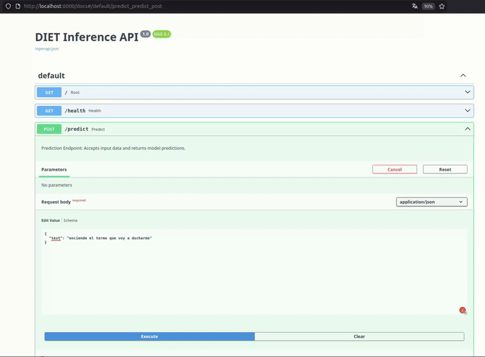

# DIET Classifier PyTorch

A PyTorch implementation of the **DIET (Dual Intent and Entity Transformer)** architecture for joint intent classification and named entity recognition in dialogue systems.

This implementation is based on the following papers:
- [DIET: Lightweight Language Understanding for Dialogue Systems](https://arxiv.org/abs/2004.09936) (Bunk et al., 2020)
- [Neural Architectures for Named Entity Recognition](https://arxiv.org/abs/1603.01360) (Lample et al., 2016)



## Table of Contents

- [Overview](#overview)
- [Installation](#installation)
- [Architecture](#architecture)
  - [Architecture Diagram](#architecture-diagram)
  - [Component Description](#component-description)
- [Mathematical Formulation](#mathematical-formulation)
  - [Sparse Feature Extraction](#sparse-feature-extraction)
  - [Transformer Encoder](#transformer-encoder)
  - [Conditional Random Field (CRF)](#conditional-random-field-crf)
- [Training Pipeline](#training-pipeline)
  - [DataLoader](#dataloader)
  - [Trainer](#trainer)
- [Usage](#usage)
- [Project Structure](#project-structure)

---

## Overview

DIET is a lightweight multi-task architecture designed for Natural Language Understanding (NLU) in dialogue systems. It jointly predicts:

1. **Intent Classification**: Determining the user's intention (e.g., "turn_on_light", "turn_off_plug")
2. **Entity Recognition**: Extracting relevant entities using BIO tagging (e.g., room names, device names)

The key advantage of DIET is that it achieves competitive performance without requiring large pre-trained language models, making it efficient for production deployment.

---

## Installation

### Using uv 

[uv](https://docs.astral.sh/uv/) is a fast Python package and project manager. To install the project with uv:

```bash
# Clone the repository
git clone https://github.com/opfernandez/diet_classifier_pytorch.git
cd diet_classifier_pytorch

# Create a virtual environment and install dependencies
uv sync
```

---

## Architecture

### Architecture Diagram

```
                              Input Text
                                  |
                                  v
                    +---------------------------+
                    |       Tokenization        |
                    |   (Whitespace + [CLS])    |
                    +---------------------------+
                                  |
                                  v
         +------------------------------------------------+
         |           Sparse Feature Extraction            |
         |                                                |
         |  +------------------+  +--------------------+  |
         |  |   Word Lookup    |  |  Char N-gram Hash  |  |
         |  |   (Embedding)    |  |  (EmbeddingBag)    |  |
         |  +------------------+  +--------------------+  |
         |            |                   |               |
         |            +-------+   +-------+               |
         |                    |   |                       |
         |                    v   v                       |
         |              +-------------+                   |
         |              |     Add     |                   |
         |              +-------------+                   |
         +------------------------------------------------+
                                  |
                                  v
                    +---------------------------+
                    |   Feed-Forward + ReLU     |
                    |      + LayerNorm          |
                    +---------------------------+
                                  |
                                  v
                    +---------------------------+
                    |   Transformer Encoder     |
                    |      (N layers)           |
                    |   - Self-Attention        |
                    |   - Feed-Forward          |
                    +---------------------------+
                                  |
                +----------------+----------------+
                |                                 |
                v                                 v
    +---------------------+           +----------------------+
    |   Entity Head       |           |    Intent Head       |
    | (Linear + CRF)      |           | (Linear + Softmax)   |
    |                     |           |                      |
    | Input: All tokens   |           | Input: [CLS] token   |
    +---------------------+           +----------------------+
                |                                 |
                v                                 v
        Entity Tags                      Intent Prediction
       (BIO format)                     (Class probabilities)
```

### Component Description

#### 1. Sparse Feature Extractor (`sparse_features_extractor.py`)

The sparse feature extractor converts raw text into dense representations through two parallel mechanisms:

- **Word Embeddings**: Each token is mapped to a learned embedding vector using a vocabulary dictionary. Out-of-vocabulary words are mapped to a special `[UNK]` token.

- **Character N-gram Embeddings**: For each token, character n-grams (default: 2 to 5 characters) are extracted and combined using an `EmbeddingBag` layer. This provides sub-word information and handles morphological variations. N-grams not in the dictionary are hashed to an overflow area using deterministic hashing.

The final token representation is the sum of word and n-gram embeddings:

$$\mathbf{h}_t = \mathbf{e}_{word}(w_t) + \sum_{g \in ngrams(w_t)} \mathbf{e}_{ngram}(g)$$

#### 2. Transformer Encoder

A standard Transformer encoder stack processes the token representations:

- **Multi-Head Self-Attention**: Allows each token to attend to all other tokens in the sequence
- **Position-wise Feed-Forward Networks**: Two linear transformations with ReLU activation
- **Layer Normalization and Dropout**: Applied for regularization

The encoder captures contextual relationships between tokens, essential for both entity recognition and intent understanding.

#### 3. Intent Classification Head

The intent is predicted using only the `[CLS]` token representation:

$$\mathbf{y}_{intent} = \text{softmax}(\mathbf{W}_{intent} \cdot \mathbf{h}_{[CLS]} + \mathbf{b}_{intent})$$

The loss is computed using Cross-Entropy:

$$\mathcal{L}_{intent} = -\sum_{c=1}^{C} y_c \log(\hat{y}_c)$$

#### 4. Conditional Random Field (CRF) for Entity Recognition (`crf.py`)

For sequence labeling, a linear-chain CRF is applied on top of the Transformer outputs. The CRF models dependencies between adjacent labels, which is crucial for BIO tagging consistency.

---

## Mathematical Formulation

### Conditional Random Field (CRF)

Following Lample et al. (2016), the CRF defines a probability distribution over tag sequences.

#### Score Function

For an input sequence $\mathbf{x}$ and tag sequence $\mathbf{y}$, the score is:

$$s(\mathbf{x}, \mathbf{y}) = \sum_{t=1}^{T} \left( A_{y_{t-1}, y_t} + P_{t, y_t} \right)$$

Where:
- $A \in \mathbb{R}^{K \times K}$ is the transition matrix (learned parameter)
- $P \in \mathbb{R}^{T \times K}$ are the emission scores from the neural network
- $A_{i,j}$ represents the score of transitioning from tag $i$ to tag $j$

#### Probability

The probability of a tag sequence is normalized over all possible sequences:

$$p(\mathbf{y}|\mathbf{x}) = \frac{\exp(s(\mathbf{x}, \mathbf{y}))}{\sum_{\tilde{\mathbf{y}} \in \mathcal{Y}_\mathbf{x}} \exp(s(\mathbf{x}, \tilde{\mathbf{y}}))}$$

#### Training Loss

The CRF loss is the negative log-likelihood:

$$\mathcal{L}_{CRF} = -\log p(\mathbf{y}|\mathbf{x}) = \log Z(\mathbf{x}) - s(\mathbf{x}, \mathbf{y})$$

Where $Z(\mathbf{x}) = \sum_{\tilde{\mathbf{y}}} \exp(s(\mathbf{x}, \tilde{\mathbf{y}}))$ is the partition function computed efficiently using the forward algorithm.

#### Forward Algorithm

The partition function is computed in $O(T \cdot K^2)$ time using dynamic programming:

$$\alpha_t(j) = \sum_{i=1}^{K} \alpha_{t-1}(i) \cdot \exp(A_{i,j} + P_{t,j})$$

In log-space (for numerical stability):

$$\log \alpha_t(j) = \text{logsumexp}_i \left( \log \alpha_{t-1}(i) + A_{i,j} + P_{t,j} \right)$$

#### Viterbi Decoding

At inference time, the most likely tag sequence is found using the Viterbi algorithm:

$$\mathbf{y}^* = \arg\max_{\mathbf{y}} s(\mathbf{x}, \mathbf{y})$$

#### Total Training Loss

The combined loss for joint training:

$$\mathcal{L}_{total} = \mathcal{L}_{CRF} + \mathcal{L}_{intent}$$

---

## Training Pipeline

### DataLoader (`data_loader.py`)

The `DataLoader` class handles data loading and preprocessing for the DIET model.

**Responsibilities:**

1. **YAML Parsing**: Reads training data in Rasa NLU format from YAML files
2. **Entity Extraction**: Parses bracketed entity annotations (e.g., `[salon](sala)`) and converts them to BIO tags
3. **Tokenization**: Splits text by whitespace and prepends `[CLS]` token
4. **Padding**: Aligns sequences within a batch to the same length using `[PAD]` tokens
5. **Batch Creation**: Groups samples into batches and shuffles them randomly

**Input Format** (Rasa NLU YAML):

```yaml
nlu:
- intent: turn_on_light
  examples: |
    - turn on the light in the [kitchen](room)
    - please activate the [living room](room) lights
```

**Output Format**:

```python
{
    "text": "[CLS] turn on the light in the kitchen",
    "entity_tags": ["O", "O", "O", "O", "O", "O", "O", "B-room"],
    "intent": "turn_on_light"
}
```

**Key Method - `format_batch()`**:
- Converts a list of samples into tensors ready for the model
- Returns: `(text_inputs, entity_tag_indices, one_hot_intent_labels)`

### Trainer (`trainer.py`)

The `Trainer` class orchestrates the training loop and model checkpointing.

**Responsibilities:**

1. **Optimization**: Uses AdamW optimizer with configurable learning rate
2. **Training Loop**: Iterates over epochs and batches, computing gradients
3. **Checkpointing**: Saves model weights when validation loss improves
4. **Visualization**: Plots training loss history using matplotlib

**Training Step**:

```
For each batch:
    1. Format batch data (text, entity labels, intent labels)
    2. Move tensors to device (CPU/GPU)
    3. Zero gradients
    4. Forward pass through model (train_forward)
    5. Compute combined loss (CRF + CrossEntropy)
    6. Backward pass
    7. Update weights
```

**Hyperparameters** (configurable in `train.py`):

| Parameter | Default | Description |
|-----------|---------|-------------|
| `batch_size` | 32 | Number of samples per batch |
| `lr` | 1e-3 | Learning rate for AdamW |
| `epochs` | 20 | Number of training epochs |
| `device` | auto | 'cuda' if available, else 'cpu' |

---

## Usage

### Languages and data

Each language (`es`, `en`, `fr`, `de`, `it`) has its own model. Instead of writing the examples by hand for every zone, device and mode, they are **generated** from templates and a catalog of names:

| File | Description |
|------|-------------|
| `data/intents.json` | Intents grouped by the entity they need (`sala`, `dispositivo`, `modo`). Language independent; it is also the `valid_intents.json` of the runtime |
| `data/names.json` | Catalog of zones, devices and modes: the Home Assistant id and its names in each language. `"ha": true` marks the ones that exist in Home Assistant |
| `data/templates/<lang>.yml` | Example phrases with slots such as `[{sala}](sala)`; `nlu` is used for training, `validation` for validation |
| `data/<lang>/` | **Generated**: `data.yml`, `validation.yml`, `intent_labels.json`, `entity_labels.json` |
| `models/<lang>/` | **Generated by training**: `diet_model.pt` plus dictionaries, labels and `model_config.json` |

`names.json` entry (the key is the suffix of the Home Assistant entity: `switch.light_<id>`, `cover.<id>`, `switch.plug_<id>`, `automation.mode_<id>`):

```json
"cocina": {"ha": true, "names": {"es": ["cocina"], "en": ["kitchen"], "fr": ["cuisine"], "de": ["küche"], "it": ["cucina"]}}
```

To add a **language** write `data/templates/<lang>.yml`, add its names in `names.json` and run the steps below. To add a **zone/device/mode** add it to `names.json` (or let `sync_ha.py` do it) and regenerate and retrain.

### Step by step

```bash
# 1. (Optional) mark which zones/devices/modes exist in Home Assistant and add the new ones
HA_URL=http://homelai-pi.local:8123 HA_TOKEN=<token> python scripts/sync_ha.py
#    -> edit data/names.json to translate the entries it lists as untranslated

# 2. Generate the training data of every language (and export the runtime files to the Raspberry repo)
python scripts/generate_data.py --export ../homelai-rpi-shs/config

# 3. Train (writes models/<lang>/diet_model.pt, ...)
python scripts/train.py --lang all                    # or: --lang en fr (--epochs 20 by default)

# 4. Validate (intent accuracy, entity F1)
python scripts/validation.py --lang en

# 5. Run the server (loads every trained language)
python scripts/inference_fastapi.py -p 8000
```

With `uv`, prefix each command with `uv run` (and run them from the repository root).

All scripts run on the **CPU** by default (enough for the Raspberry Pi). Use `--device auto` to use the GPU when it works (`--device cuda` to force it); note that the `torch==2.5.1` pinned in `pyproject.toml` has no kernels for RTX 50xx GPUs (`sm_120`).

### Training

```bash
python scripts/train.py --lang en            # one language
python scripts/train.py --lang en fr de it   # several
python scripts/train.py --lang all           # every language in data/
```

Options: `--epochs` (default 20; more epochs lower the loss but check `validation.py`, they can overfit the templates), `--batch-size`, `--lr`, `--plot`. This will:
1. Load `data/<lang>/data.yml`
2. Build word and n-gram dictionaries, sized to the corpus
3. Train the DIET model
4. Save the best checkpoint and all the artifacts to `models/<lang>/`

### Validation

```bash
python scripts/validation.py --lang en
```

This will:
1. Load `data/<lang>/validation.yml`
2. Load the trained model from `models/<lang>/diet_model.pt`
3. Compute F1 score for entity recognition
4. Compute accuracy for intent classification
5. Display the confusion matrix (`--no-plot` to skip it)

### Inference Server

The project includes a inference server for production deployment. Any API REST server can wrap this class for integration.

**Response format:**
```json
{
    "status": "success",
    "result": {
        "text": "encender la luz de la cocina",
        "intent": "turn_on_light",
        "intent_confidence": 0.95,
        "entities": [
            {"type": "room", "start": 4, "end": 4, "words": "cocina"}
        ],
        "inference_time_ms": 2.5
    }
}
```

### FastAPI Inference Server

The project also includes a REST API server using FastAPI for easier integration:

#### Running Locally

```bash
python scripts/inference_fastapi.py -p <your_port>
python scripts/inference_fastapi.py --langs es en --default-lang es   # only some languages
```

The server loads the trained model of every language in `models/` (or the ones in `--langs`) and starts on `http://0.0.0.0:<your_port>` (default `8000`). Each request chooses its model with the optional `language` field; without it, `--default-lang` (the first language loaded) is used.

#### API Endpoints

| Endpoint | Method | Description |
|----------|--------|-------------|
| `/` | GET | API information |
| `/health` | GET | Health check |
| `/predict` | POST | Perform inference |

#### Example Request

```bash
curl -X POST "http://localhost:8000/predict" \
     -H "Content-Type: application/json" \
     -d '{"text": "turn on the kitchen light", "language": "en"}'
```

**Response:**
```json
{
    "status": "success",
    "language": "en",
    "result": {
        "text": "encender la luz de la cocina",
        "intent": "turn_on_light",
        "intent_confidence": 0.95,
        "entities": [
            {"type": "room", "start": 4, "end": 4, "words": "cocina"}
        ],
        "inference_time_ms": 2.5
    }
}
```

---

### Docker Deployment

The project includes a Dockerfile for containerized deployment.

Trained models are **not** copied into the image: mount `models/` (one folder per language, created by `train.py`). The image runs on the CPU.

#### Building the Docker Image

```bash
docker build -t diet-classifier .
```

#### Running the Container

```bash
docker run -p 8000:8000 -v "$PWD/models:/app/models:ro" diet-classifier

# Only some languages / another default language
docker run -p 8000:8000 -v "$PWD/models:/app/models:ro" diet-classifier \
    /app/.venv/bin/python scripts/inference_fastapi.py --langs es en --default-lang es
```

To run it together with the MQTT broker and the voice assistant use the `docker-compose.yml` of [homelai-rpi-shs](https://github.com/grupo-avispa/homelai-rpi-shs).

#### Testing the Container

Once the container is running, you can test the API:

```bash
# Health check
curl http://localhost:8000/health

# Prediction
curl -X POST "http://localhost:8000/predict" \
     -H "Content-Type: application/json" \
     -d '{"text": "apaga el enchufe del televisor", "language": "es"}'
```

The API can also be tested accesing the automatically generated Swagger UI at `http://localhost:8000/docs`. For that, just open a web browser and navigate to that URL, then click on the `/predict` endpoint to try it out. 

---

### Programmatic Inference

```python
from diet_classifier.inference import DIETServer

# Initialize server (also works for direct inference)
server = DIETServer(
    device='cuda',  # or 'cpu'
    model_path='models/en/diet_model.pt',
    word_dict_path='models/en/word_dict.json',
    ngram_dict_path='models/en/ngram_dict.json',
    entity_labels_path='models/en/entity_labels.json',
    intent_labels_path='models/en/intent_labels.json',
    model_config_path='models/en/model_config.json'
)

# Perform inference
results = server.predict(["turn on the light in the kitchen"])
print(results[0])
```

---

## Project Structure

```
diet_classifier_pytorch/
├── pyproject.toml              # Project configuration and dependencies
├── Dockerfile                  # Docker container configuration
├── README.md
│
├── data/
│   ├── intents.json            # Intents by entity type (shared by all languages)
│   ├── names.json              # Catalog of zones/devices/modes and their names per language
│   ├── templates/<lang>.yml    # Example templates (train + validation) per language
│   └── <lang>/                 # Generated: data.yml, validation.yml, *_labels.json
│
├── models/
│   └── <lang>/                 # Generated: diet_model.pt, dictionaries, labels, model_config.json
│
├── scripts/
│   ├── sync_ha.py              # Sync names.json with the zones/devices/modes of Home Assistant
│   ├── generate_data.py        # Templates + names -> data/<lang>/ (+ export to the Raspberry repo)
│   ├── train.py                # Training entry point (--lang)
│   ├── validation.py           # Validation and metrics computation (--lang)
│   ├── langs.py                # Per-language paths shared by the scripts
│   └── inference_fastapi.py    # FastAPI REST inference server (all languages)
│
└── src/
    └── diet_classifier/
        ├── __init__.py
        │
        ├── model/
        │   ├── __init__.py
        │   ├── diet.py                     # Main DIET model architecture
        │   ├── crf.py                      # Conditional Random Field implementation
        │   └── sparse_features_extractor.py # Word and n-gram feature extraction
        │
        ├── training/
        │   ├── __init__.py
        │   ├── trainer.py                  # Training loop and checkpointing
        │   └── data_loader.py              # Data loading and preprocessing
        │
        └── inference/
            ├── __init__.py
            └── server.py                   # DIETServer class for inference
```

---

## References

1. Bunk, T., Varshneya, D., Vlasov, V., & Nichol, A. (2020). *DIET: Lightweight Language Understanding for Dialogue Systems*. arXiv:2004.09936.

2. Lample, G., Ballesteros, M., Subramanian, S., Kawakami, K., & Dyer, C. (2016). *Neural Architectures for Named Entity Recognition*. NAACL-HLT 2016. arXiv:1603.01360.

---

## License

This project is provided as-is for educational and research purposes.
